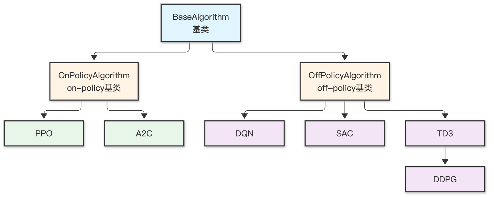
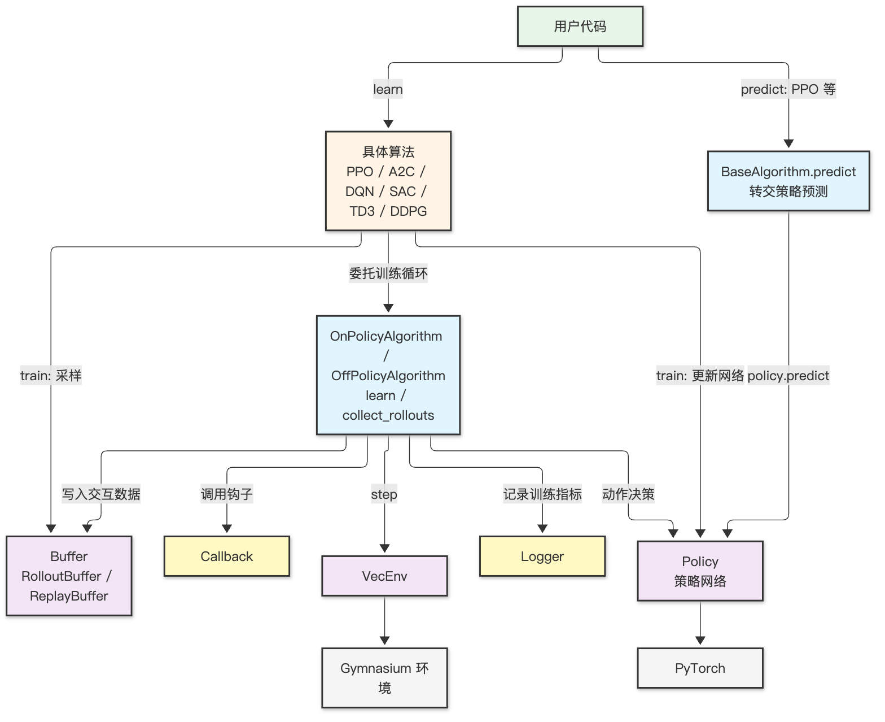

# 2. 项目地图与阅读顺序

## 2.1 范围与仓库入口

Stable-Baselines3（SB3）基于 PyTorch，实现 PPO、A2C、DQN、DDPG、SAC、TD3。本文使用[固定源码基线](../project-baseline.md)：`7cfb4dd6055e74b5caa4ed4d6777492209946e26`。Python 包含 64 个 Python 文件，共 15,693 行；统计方法见[任务证据](../evidence/issues/issue-01.md)。

| 目录/入口 | 职责 | 固定基线下的代表文件 |
|---|---|---|
| `README.md` | 项目介绍、安装方式、算法支持表和最小使用示例 | [README.md](https://github.com/DLR-RM/stable-baselines3/blob/7cfb4dd6055e74b5caa4ed4d6777492209946e26/README.md#L11) |
| `stable_baselines3/` | 算法、策略、缓冲区与环境包装实现 | [__init__.py](https://github.com/DLR-RM/stable-baselines3/blob/7cfb4dd6055e74b5caa4ed4d6777492209946e26/stable_baselines3/__init__.py#L1) |
| `tests/` | 验证预测接口、训练流程和边界行为 | [test_predict.py::test_predict](https://github.com/DLR-RM/stable-baselines3/blob/7cfb4dd6055e74b5caa4ed4d6777492209946e26/tests/test_predict.py#L62)；[test_run.py::test_ppo](https://github.com/DLR-RM/stable-baselines3/blob/7cfb4dd6055e74b5caa4ed4d6777492209946e26/tests/test_run.py#L49) |
| `docs/` | 用户指南和开发者设计说明；帮助区分公开接口与内部实现 | [docs/guide/developer.md](https://github.com/DLR-RM/stable-baselines3/blob/7cfb4dd6055e74b5caa4ed4d6777492209946e26/docs/guide/developer.md#L14) |
| `.github/` | GitHub 协作模板与自动化流程；CI 执行 lint、文档构建、类型检查和测试 | [.github/workflows/ci.yml](https://github.com/DLR-RM/stable-baselines3/blob/7cfb4dd6055e74b5caa4ed4d6777492209946e26/.github/workflows/ci.yml#L1) |
| `scripts/` | 测试和 Docker 运行辅助脚本 | [scripts/run_tests.sh](https://github.com/DLR-RM/stable-baselines3/blob/7cfb4dd6055e74b5caa4ed4d6777492209946e26/scripts/run_tests.sh#L1) |

## 2.2 架构与模块职责



[Mermaid 源文件](../../artifacts/diagrams/issue-01/architecture.mmd)

`BaseAlgorithm` 提供公共初始化、环境包装、保存/加载和预测入口，`learn()` 是抽象接口。`OnPolicyAlgorithm` / `OffPolicyAlgorithm` 实现训练循环，具体算法实现 `train()`。DDPG 继承 TD3，复用其实现；它比其他算法多一层。

| 组件 | 文件 | 职责 |
|---|---|---|
| Policy | `common/policies.py`；各算法的 `policies.py` | 包含预测和训练所用网络；PPO 的策略名称是公共 ActorCriticPolicy 等类的别名 |
| Buffer | `common/buffers.py` | RolloutBuffer 存储本轮采集的数据；ReplayBuffer 保留历史经验供重复采样 |
| VecEnv | `common/vec_env/` | 管理一个或多个环境，为算法提供统一交互接口 |
| Callback / Logger | `common/callbacks.py`、`common/logger.py` | 提供训练钩子并记录指标 |
| 环境检查 | `common/env_checker.py` | 检查自定义环境是否符合 SB3 支持的接口与空间约束 |
| 网络辅助 | `common/preprocessing.py`、`torch_layers.py`、`distributions.py` | 预处理观察、提取特征、构造动作分布 |



[Mermaid 源文件](../../artifacts/diagrams/issue-01/module-collaboration.mmd)。箭头表示调用或数据操作，不表示类继承。

训练时，中间层的 `learn()` 调用 `collect_rollouts()`，后者通过 Policy 与 VecEnv 采集数据、写入 Buffer 并调用 Callback；随后具体算法的 `train()` 从 Buffer 采样并更新网络。预测时，PPO 等算法沿 `BaseAlgorithm.predict()` → `policy.predict()` 执行；DQN 有自己的探索逻辑。源码定位见下表和阅读路线，设计说明见[开发指南](https://github.com/DLR-RM/stable-baselines3/blob/7cfb4dd6055e74b5caa4ed4d6777492209946e26/docs/guide/developer.md#L20)。

## 2.3 关键入口

| 入口 | 固定源码位置 | 职责 |
|---|---|---|
| 导入 | [__init__.py](https://github.com/DLR-RM/stable-baselines3/blob/7cfb4dd6055e74b5caa4ed4d6777492209946e26/stable_baselines3/__init__.py#L1) | 导出 PPO、A2C、DQN、DDPG、SAC、TD3 |
| 训练 | [BaseAlgorithm.learn](https://github.com/DLR-RM/stable-baselines3/blob/7cfb4dd6055e74b5caa4ed4d6777492209946e26/stable_baselines3/common/base_class.py#L512)；[OnPolicyAlgorithm.learn](https://github.com/DLR-RM/stable-baselines3/blob/7cfb4dd6055e74b5caa4ed4d6777492209946e26/stable_baselines3/common/on_policy_algorithm.py#L300)；[OffPolicyAlgorithm.learn](https://github.com/DLR-RM/stable-baselines3/blob/7cfb4dd6055e74b5caa4ed4d6777492209946e26/stable_baselines3/common/off_policy_algorithm.py#L324) | 基类声明接口，中间层执行训练循环 |
| 预测 | [BaseAlgorithm.predict](https://github.com/DLR-RM/stable-baselines3/blob/7cfb4dd6055e74b5caa4ed4d6777492209946e26/stable_baselines3/common/base_class.py#L537) | 转交 `policy.predict()`；DQN 覆盖此入口以加入探索 |
| 保存/加载 | [save](https://github.com/DLR-RM/stable-baselines3/blob/7cfb4dd6055e74b5caa4ed4d6777492209946e26/stable_baselines3/common/base_class.py#L819)；[load](https://github.com/DLR-RM/stable-baselines3/blob/7cfb4dd6055e74b5caa4ed4d6777492209946e26/stable_baselines3/common/base_class.py#L643) | 保存参数和配置；加载时的新环境必须匹配原观察与动作空间 |
| 环境包装 | [_wrap_env](https://github.com/DLR-RM/stable-baselines3/blob/7cfb4dd6055e74b5caa4ed4d6777492209946e26/stable_baselines3/common/base_class.py#L204) | 将普通 Gymnasium 环境包装成 VecEnv，按需添加 Monitor、转换图像通道顺序 |

一个完整的使用示例：

```python
import gymnasium as gym
from stable_baselines3 import PPO

env = gym.make("CartPole-v1")
model = PPO("MlpPolicy", env, verbose=1)
model.learn(total_timesteps=10000)
model.save("ppo_cartpole")
model = PPO.load("ppo_cartpole")
obs, info = env.reset()
action, _states = model.predict(obs, deterministic=True)
env.close()
```

## 2.4 推荐阅读顺序

先按[基线说明](../project-baseline.md)检出上游源码并建立虚拟环境，在上游仓库安装：

```bash
uv pip install -e '.[extra,tests]'
```

### 路线1：从用户入口到公共骨架（T02 起点）

1. 读上游 `README.md` 与 `docs/guide/developer.md`，运行上面的示例，确认使用方式与职责分工。
2. 读 `stable_baselines3/__init__.py`，找到算法导出入口。
3. 读 `common/base_class.py:L67-L202` 和 `common/on_policy_algorithm.py:L21-L113`，区分公共初始化与 on-policy 配置。
4. 读 `ppo/ppo.py:L18-L136`，查看具体算法的初始化和超参数；T02 可据此继续分析对象关系。

这个顺序先建立使用场景，再比较基类与具体算法，避免把公共行为全部归给 PPO。

### 路线2：沿预测数据流阅读（T03 起点）

| 顺序 | 固定源码位置 | 阅读重点 |
|---|---|---|
| 1 | [BaseAlgorithm.predict](https://github.com/DLR-RM/stable-baselines3/blob/7cfb4dd6055e74b5caa4ed4d6777492209946e26/stable_baselines3/common/base_class.py#L537) | 公共算法入口如何转交 Policy |
| 2 | [BasePolicy.predict](https://github.com/DLR-RM/stable-baselines3/blob/7cfb4dd6055e74b5caa4ed4d6777492209946e26/stable_baselines3/common/policies.py#L331)；[BaseModel.obs_to_tensor](https://github.com/DLR-RM/stable-baselines3/blob/7cfb4dd6055e74b5caa4ed4d6777492209946e26/stable_baselines3/common/policies.py#L236) | 输入检查、批次维度和 Tensor 转换 |
| 3 | [ActorCriticPolicy._predict](https://github.com/DLR-RM/stable-baselines3/blob/7cfb4dd6055e74b5caa4ed4d6777492209946e26/stable_baselines3/common/policies.py#L709)；[get_distribution](https://github.com/DLR-RM/stable-baselines3/blob/7cfb4dd6055e74b5caa4ed4d6777492209946e26/stable_baselines3/common/policies.py#L743) | PPO 预测通过动作分布取动作；与训练时的 `forward()` 区分 |
| 4 | [preprocess_obs](https://github.com/DLR-RM/stable-baselines3/blob/7cfb4dd6055e74b5caa4ed4d6777492209946e26/stable_baselines3/common/preprocessing.py#L91)；[torch_layers.py](https://github.com/DLR-RM/stable-baselines3/blob/7cfb4dd6055e74b5caa4ed4d6777492209946e26/stable_baselines3/common/torch_layers.py#L1)；[distributions.py](https://github.com/DLR-RM/stable-baselines3/blob/7cfb4dd6055e74b5caa4ed4d6777492209946e26/stable_baselines3/common/distributions.py#L1) | 按数据流核对预处理、特征提取和动作分布 |
| 5 | [tests/test_predict.py::test_predict](https://github.com/DLR-RM/stable-baselines3/blob/7cfb4dd6055e74b5caa4ed4d6777492209946e26/tests/test_predict.py#L62) | 用测试核对输入、输出及设备行为 |

用 CartPole 查看观察转换和预测结果：

```python
import gymnasium as gym
from stable_baselines3 import PPO
from stable_baselines3.common.preprocessing import preprocess_obs

env = gym.make("CartPole-v1")
model = PPO("MlpPolicy", env)

# 打印中间结果，理解数据流
obs, info = env.reset()  # Gymnasium 的 reset() 返回 (obs, info)
print("原始观察:", obs.shape)

# preprocess_obs 要求输入 PyTorch Tensor，先用策略自带的 obs_to_tensor 转换
obs_tensor, _ = model.policy.obs_to_tensor(obs)
preprocessed = preprocess_obs(obs_tensor, model.observation_space)
print("预处理后:", preprocessed.shape)

# 预测（predict 内部会自动完成上面的转换）
action, _ = model.predict(obs, deterministic=True)
print("输出动作:", action)
```

### 路线3：沿采集、存储、更新阅读（T04 起点）

| 顺序 | 固定源码位置 | 阅读重点 |
|---|---|---|
| 1 | [OnPolicyAlgorithm.learn](https://github.com/DLR-RM/stable-baselines3/blob/7cfb4dd6055e74b5caa4ed4d6777492209946e26/stable_baselines3/common/on_policy_algorithm.py#L300) | 采集与更新如何交替，何时退出 |
| 2 | [collect_rollouts](https://github.com/DLR-RM/stable-baselines3/blob/7cfb4dd6055e74b5caa4ed4d6777492209946e26/stable_baselines3/common/on_policy_algorithm.py#L162) | 策略决策、环境交互、数据写入和回调钩子 |
| 3 | [RolloutBuffer](https://github.com/DLR-RM/stable-baselines3/blob/7cfb4dd6055e74b5caa4ed4d6777492209946e26/stable_baselines3/common/buffers.py#L343) | 数据存储、回报/优势计算和采样；ReplayBuffer 从 L158 开始，用于 off-policy |
| 4 | [PPO.train](https://github.com/DLR-RM/stable-baselines3/blob/7cfb4dd6055e74b5caa4ed4d6777492209946e26/stable_baselines3/ppo/ppo.py#L184) | 从缓冲区取数据并更新网络；不展开 PPO 公式推导 |
| 5 | [callbacks.py](https://github.com/DLR-RM/stable-baselines3/blob/7cfb4dd6055e74b5caa4ed4d6777492209946e26/stable_baselines3/common/callbacks.py#L1)；[logger.py](https://github.com/DLR-RM/stable-baselines3/blob/7cfb4dd6055e74b5caa4ed4d6777492209946e26/stable_baselines3/common/logger.py#L1) | 回调和日志怎样接入循环 |
| 6 | [tests/test_run.py::test_ppo](https://github.com/DLR-RM/stable-baselines3/blob/7cfb4dd6055e74b5caa4ed4d6777492209946e26/tests/test_run.py#L49) | 用短训练测试核对流程能否运行 |

对照 off-policy 时，从 `common/off_policy_algorithm.py:L324` 的 `learn()` 和 L526 的 `collect_rollouts()` 继续，注意其 ReplayBuffer 和更新频率。

以下例子展示独立评估环境与日志配置：

```python
# 使用独立评估环境，并启用 TensorBoard 事件日志
import gymnasium as gym
from stable_baselines3 import PPO
from stable_baselines3.common.callbacks import EvalCallback
from stable_baselines3.common.monitor import Monitor

train_env = gym.make("CartPole-v1")
eval_env = Monitor(gym.make("CartPole-v1"))
model = PPO("MlpPolicy", train_env, tensorboard_log="./logs/", verbose=1)
eval_callback = EvalCallback(
    eval_env,
    best_model_save_path="./logs/",
    log_path="./logs/",
    eval_freq=1000,
    verbose=1,
)
model.learn(total_timesteps=10000, callback=eval_callback)
train_env.close()
eval_env.close()

# 终端运行：uv run tensorboard --logdir ./logs/
```

`tensorboard_log` 生成 TensorBoard 事件文件；`EvalCallback.log_path` 保存 `evaluations.npz`。这里使用一个训练环境，`eval_freq` 按回调调用次数计算。

两段练习的运行命令与结果见[任务证据](../evidence/issues/issue-01.md#示例运行验证)。T05 可从 `_wrap_env()` 和 `env_checker.py` 继续，T06 可复用示例验证运行行为。
