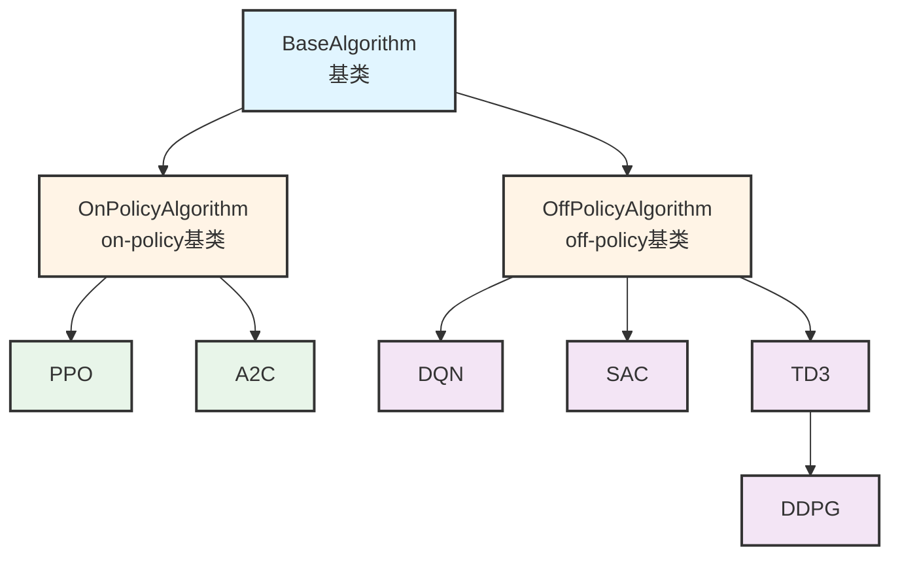
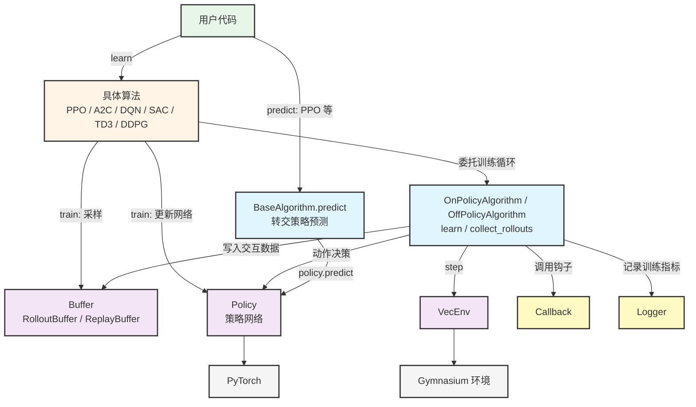

# 2. 项目地图

## 2.1 项目概况

Stable-Baselines3（简称SB3）是一个强化学习算法库，基于PyTorch实现。它提供了6种常用的强化学习算法，都遵循统一的API接口。

**基本数据**：
- 代码规模：64个Python文件，约15,693行代码
- 支持算法：PPO、A2C、DQN、DDPG、SAC、TD3
- 环境标准：Gymnasium（OpenAI Gym的升级版）

## 2.2 整体架构

### 2.2.1 目录结构

```
stable_baselines3/
├── __init__.py              # 导出所有算法
├── common/                  # 公共代码（所有算法共用）
│   ├── base_class.py        # 算法基类
│   ├── on_policy_algorithm.py   # on-policy算法基类
│   ├── off_policy_algorithm.py  # off-policy算法基类
│   ├── policies.py          # 策略网络
│   ├── buffers.py           # 数据缓冲区
│   └── ...                  # 其他工具模块
├── ppo/                     # PPO算法
├── a2c/                     # A2C算法
├── dqn/                     # DQN算法
├── ddpg/                    # DDPG算法
├── sac/                     # SAC算法
└── td3/                     # TD3算法
```

这里的 `stable_baselines3/` 是上游仓库中的 Python 包。完整仓库还包括以下入口，不能把包目录当作整个项目：

| 目录/入口 | 职责 | 固定基线下的代表文件 |
|---|---|---|
| `README.md` | 项目介绍、安装方式、算法支持表和最小使用示例 | [README.md](https://github.com/DLR-RM/stable-baselines3/blob/7cfb4dd6055e74b5caa4ed4d6777492209946e26/README.md#L11) |
| `stable_baselines3/` | 算法、策略、缓冲区与环境包装实现 | [__init__.py](https://github.com/DLR-RM/stable-baselines3/blob/7cfb4dd6055e74b5caa4ed4d6777492209946e26/stable_baselines3/__init__.py#L1) |
| `tests/` | 验证预测接口、训练流程和边界行为 | [test_predict.py::test_predict](https://github.com/DLR-RM/stable-baselines3/blob/7cfb4dd6055e74b5caa4ed4d6777492209946e26/tests/test_predict.py#L62)；[test_run.py::test_ppo](https://github.com/DLR-RM/stable-baselines3/blob/7cfb4dd6055e74b5caa4ed4d6777492209946e26/tests/test_run.py#L49) |
| `docs/` | 用户指南和开发者设计说明；帮助区分公开接口与内部实现 | [docs/guide/developer.md](https://github.com/DLR-RM/stable-baselines3/blob/7cfb4dd6055e74b5caa4ed4d6777492209946e26/docs/guide/developer.md#L14) |
| `.github/` | GitHub 协作模板与自动化流程；CI 执行 lint、文档构建、类型检查和测试 | [.github/workflows/ci.yml](https://github.com/DLR-RM/stable-baselines3/blob/7cfb4dd6055e74b5caa4ed4d6777492209946e26/.github/workflows/ci.yml#L1) |
| `scripts/` | 测试和 Docker 运行辅助脚本 | [scripts/run_tests.sh](https://github.com/DLR-RM/stable-baselines3/blob/7cfb4dd6055e74b5caa4ed4d6777492209946e26/scripts/run_tests.sh#L1) |

职责依据是上表文件的内容；“先读 README 与开发指南，再从包入口追到具体算法，最后用测试核对行为”是本任务推荐的阅读路线。

### 2.2.2 架构图



[可编辑源文件](../../artifacts/diagrams/issue-01/architecture.mmd) · [导出图](../../artifacts/diagrams/issue-01/01architecture.png)

**图说明**：
- 🔵 蓝色：顶层基类（所有算法共同的接口）
- 🟡 黄色：中间层（区分算法类型）
- 🟢 绿色：on-policy算法（训练后丢弃数据）
- 🟣 紫色：off-policy算法（可重用历史数据）

> 注意：DDPG 不是直接继承 `OffPolicyAlgorithm`，而是继承 TD3（`ddpg/ddpg.py:L14`：`class DDPG(TD3)`）。源码注释说明 SB3 把 DDPG 当作 TD3 的一个特例来实现。

### 2.2.3 三层设计

**第一层：BaseAlgorithm**
- 位置：`common/base_class.py`
- 作用：定义所有算法的通用方法
- 主要方法：`learn()`, `predict()`, `save()`, `load()`
- 注意：这里的 `learn()` 只是抽象方法（没有具体实现），真正的训练循环写在第二层

**第二层：OnPolicy/OffPolicy**
- On-policy（`on_policy_algorithm.py`）：用于PPO、A2C
- Off-policy（`off_policy_algorithm.py`）：用于DQN、SAC、TD3（以及继承TD3的DDPG）
- 作用：区分数据使用方式，并实现各自的 `learn()` 训练循环

**第三层：具体算法**
- 每个算法一个文件夹（如`ppo/`）
- 实现自己的训练逻辑（`train()`方法）
- 特例：DDPG 继承 TD3，复用了 TD3 的大部分实现

### 2.2.4 另一视角—模块协作地图

从另一个视角看，SB3项目的各个模块是如何协作完成训练和预测任务的：



[可编辑源文件](../../artifacts/diagrams/issue-01/module-collaboration.mmd) · [导出图](../../artifacts/diagrams/issue-01/02module-collaboration.png)

**图说明**：

这张图区分训练调度、具体算法更新与预测入口：

- 🟢 **用户层**：用户编写的训练/测试代码
- 🟡 **算法层**：用户选择的具体算法（PPO、DQN等）
- 🔵 **公共骨架**：OnPolicy/OffPolicy 负责训练调度，BaseAlgorithm 提供公共预测入口
- 🟨 **工具模块**：辅助功能（环境包装、回调、日志）
- ⚪ **外部依赖**：Gymnasium环境标准和PyTorch深度学习框架

**核心协作流程**：

1. **用户代码** 创建算法实例，并调用 `learn()` 或 `predict()`。
2. **训练调度** 位于 `OnPolicyAlgorithm` / `OffPolicyAlgorithm`：`learn()` 调用 `collect_rollouts()`，后者使用 Policy 决策、通过 VecEnv 与环境交互、写入 Buffer，并调用 Callback 钩子；`learn()` 再调用具体算法的 `train()` 更新网络。
3. **具体算法的 `train()`** 从 Buffer 采样，计算损失并优化 Policy；中间层和具体算法通过 Logger 记录指标。
4. **预测入口** 对 PPO 等沿用基类实现的算法，是 `BaseAlgorithm.predict()` → `policy.predict()`；DQN 覆盖了算法层的 `predict()`，加入探索逻辑。
5. **BaseAlgorithm** 提供公共初始化、环境包装、回调/日志准备、保存与加载，以及抽象 `learn()` 接口；它不实现训练循环，也不负责创建和读写训练 Buffer。
6. **底层依赖**：Gymnasium 提供环境接口，PyTorch 实现神经网络。

图中的箭头表示所标注的方法调用或数据操作，不表示类继承。Callback 是训练循环的一部分，即使用户没有传入自定义回调，也会初始化回调对象。

**源码依据**：[BaseAlgorithm.learn（抽象接口）](https://github.com/DLR-RM/stable-baselines3/blob/7cfb4dd6055e74b5caa4ed4d6777492209946e26/stable_baselines3/common/base_class.py#L511)；[OnPolicyAlgorithm._setup_model](https://github.com/DLR-RM/stable-baselines3/blob/7cfb4dd6055e74b5caa4ed4d6777492209946e26/stable_baselines3/common/on_policy_algorithm.py#L115)；[OnPolicyAlgorithm.collect_rollouts](https://github.com/DLR-RM/stable-baselines3/blob/7cfb4dd6055e74b5caa4ed4d6777492209946e26/stable_baselines3/common/on_policy_algorithm.py#L162)；[OnPolicyAlgorithm.learn](https://github.com/DLR-RM/stable-baselines3/blob/7cfb4dd6055e74b5caa4ed4d6777492209946e26/stable_baselines3/common/on_policy_algorithm.py#L300)；[OffPolicyAlgorithm._setup_model](https://github.com/DLR-RM/stable-baselines3/blob/7cfb4dd6055e74b5caa4ed4d6777492209946e26/stable_baselines3/common/off_policy_algorithm.py#L177)；[OffPolicyAlgorithm.collect_rollouts](https://github.com/DLR-RM/stable-baselines3/blob/7cfb4dd6055e74b5caa4ed4d6777492209946e26/stable_baselines3/common/off_policy_algorithm.py#L526)；[PPO.train](https://github.com/DLR-RM/stable-baselines3/blob/7cfb4dd6055e74b5caa4ed4d6777492209946e26/stable_baselines3/ppo/ppo.py#L184)；[BaseAlgorithm.predict](https://github.com/DLR-RM/stable-baselines3/blob/7cfb4dd6055e74b5caa4ed4d6777492209946e26/stable_baselines3/common/base_class.py#L537)。设计说明另见 [开发指南](https://github.com/DLR-RM/stable-baselines3/blob/7cfb4dd6055e74b5caa4ed4d6777492209946e26/docs/guide/developer.md#L20)。

这个视角帮助理解：**SB3如何将用户的简单调用，转化为复杂的强化学习训练流程**。

## 2.3 关键入口

### 入口速查表

| 入口 | 位置 | 作用 |
|------|------|------|
| **算法导入** | `stable_baselines3/__init__.py` | 导出PPO、DQN等算法类 |
| **模型训练** | `common/base_class.py` → `learn()`（接口）<br/>`on_policy_algorithm.py` / `off_policy_algorithm.py` → `learn()`（实现） | 训练强化学习模型 |
| **动作预测** | `common/base_class.py` → `predict()` | 根据观察预测动作 |
| **模型保存** | `common/base_class.py` → `save()` | 保存训练好的模型 |
| **模型加载** | `common/base_class.py` → `load()` | 加载已保存的模型 |
| **环境包装** | `common/base_class.py` → `_wrap_env()` | 自动包装Gymnasium环境 |

---

### 1. 算法导入入口

**文件**：`stable_baselines3/__init__.py`

**固定链接**：https://github.com/DLR-RM/stable-baselines3/blob/7cfb4dd6055e74b5caa4ed4d6777492209946e26/stable_baselines3/__init__.py


**说明**：用户使用SB3的第一步，从这个文件导入需要的算法。统一的导出接口让用户不需要关心算法的具体位置。

**使用示例**：
```python
from stable_baselines3 import PPO, DQN, SAC
```

---

### 2. 模型训练入口

**文件**：`stable_baselines3/common/base_class.py`（接口）、`common/on_policy_algorithm.py` / `common/off_policy_algorithm.py`（实现）

**固定链接**：
- 接口 `BaseAlgorithm.learn()`（L512）：https://github.com/DLR-RM/stable-baselines3/blob/7cfb4dd6055e74b5caa4ed4d6777492209946e26/stable_baselines3/common/base_class.py#L512
- 实现 `OnPolicyAlgorithm.learn()`（L300）：https://github.com/DLR-RM/stable-baselines3/blob/7cfb4dd6055e74b5caa4ed4d6777492209946e26/stable_baselines3/common/on_policy_algorithm.py#L300
- 实现 `OffPolicyAlgorithm.learn()`（L324）：https://github.com/DLR-RM/stable-baselines3/blob/7cfb4dd6055e74b5caa4ed4d6777492209946e26/stable_baselines3/common/off_policy_algorithm.py#L324

**方法**：`learn(total_timesteps, callback=None, ...)`

**核心流程**：
```
初始化 → 训练循环 → 返回模型
         ├─ 收集数据（与环境交互）
         ├─ 更新策略（训练神经网络）
         └─ 记录日志
```

**说明**：所有算法的统一训练接口。无论使用PPO、DQN还是SAC，都是调用`learn()`方法开始训练。`BaseAlgorithm` 里的 `learn()` 是抽象方法，只规定了参数；上面的训练循环实际写在两个中间层里。

**使用示例**：
```python
model = PPO("MlpPolicy", "CartPole-v1")
model.learn(total_timesteps=10000)
```

---

### 3. 动作预测入口

**文件**：`stable_baselines3/common/base_class.py`

**固定链接**：https://github.com/DLR-RM/stable-baselines3/blob/7cfb4dd6055e74b5caa4ed4d6777492209946e26/stable_baselines3/common/base_class.py#L537

**方法**：`predict(observation, deterministic=False, ...)`

**核心流程**：
```
观察值 → 预处理 → 神经网络 → 动作
```

**说明**：训练后使用模型的接口。根据当前观察值，通过策略网络计算并返回应该执行的动作。

**使用示例**：
```python
obs, info = env.reset()  # Gymnasium 的 reset() 返回 (obs, info)
action, _states = model.predict(obs, deterministic=True)
```

---

### 4. 模型保存入口

**文件**：`stable_baselines3/common/base_class.py`

**固定链接**：https://github.com/DLR-RM/stable-baselines3/blob/7cfb4dd6055e74b5caa4ed4d6777492209946e26/stable_baselines3/common/base_class.py#L819

**方法**：`save(path)`

**说明**：将训练好的模型保存到文件，包括神经网络参数、超参数配置等。保存后可以随时加载使用，无需重新训练。

**使用示例**：
```python
model.save("ppo_cartpole")
```

---

### 5. 模型加载入口

**文件**：`stable_baselines3/common/base_class.py`

**固定链接**：https://github.com/DLR-RM/stable-baselines3/blob/7cfb4dd6055e74b5caa4ed4d6777492209946e26/stable_baselines3/common/base_class.py#L643

**方法**：`load(path, env=None, ...)`（类方法）

**说明**：从文件加载已保存的模型。可以在加载时指定新的环境，这样同一个模型可以在不同环境中测试。

**使用示例**：
```python
model = PPO.load("ppo_cartpole")
# 或指定环境
model = PPO.load("ppo_cartpole", env=new_env)
```

---

### 6. 环境包装入口

**文件**：`stable_baselines3/common/base_class.py`

**固定链接**：https://github.com/DLR-RM/stable-baselines3/blob/7cfb4dd6055e74b5caa4ed4d6777492209946e26/stable_baselines3/common/base_class.py#L204

**方法**：`_wrap_env(env, verbose=0, monitor_wrapper=True)`（静态方法）

**说明**：自动将Gymnasium环境包装成SB3需要的格式。主要功能包括：
- 包装成向量化环境（VecEnv）
- 添加Monitor记录episode信息
- 处理图像观察的通道顺序

**核心逻辑**：用户传入的环境会自动经过这个方法包装，通常不需要手动调用。

---

### 完整使用流程示例

```python
import gymnasium as gym
from stable_baselines3 import PPO

# 1. 导入算法（从 __init__.py）
# 2. 创建环境
env = gym.make("CartPole-v1")

# 3. 创建模型（自动调用 _wrap_env 包装环境）
model = PPO("MlpPolicy", env, verbose=1)

# 4. 训练（调用 learn()）
model.learn(total_timesteps=10000)

# 5. 保存（调用 save()）
model.save("ppo_cartpole")

# 6. 加载（调用 load()）
model = PPO.load("ppo_cartpole")

# 7. 使用（调用 predict()）
obs, info = env.reset()
action, _states = model.predict(obs, deterministic=True)
```


## 2.4 推荐阅读顺序

### 快速开始指南（参考官方 README，使用本项目固定源码基线）

在深入代码之前，建议先通过以下方式快速上手：

#### 1. 安装SB3

```bash
# 完整安装（包含TensorBoard、OpenCV等）
# 先按 docs/project-baseline.md 检出固定 commit，在上游仓库中安装
uv pip install -e '.[extra,tests]'

```

**环境要求**：
- Python 3.10+
- PyTorch >= 2.8

#### 2. 也可在线试用（不需要本地安装）

SB3提供了Google Colab笔记本，可以直接在浏览器中运行：

- [快速入门教程](https://colab.research.google.com/github/Stable-Baselines-Team/rl-colab-notebooks/blob/sb3/stable_baselines_getting_started.ipynb)
- [保存和加载模型](https://colab.research.google.com/github/Stable-Baselines-Team/rl-colab-notebooks/blob/sb3/saving_loading_dqn.ipynb)
- [多进程训练](https://colab.research.google.com/github/Stable-Baselines-Team/rl-colab-notebooks/blob/sb3/multiprocessing_rl.ipynb)
- [监控训练过程](https://colab.research.google.com/github/Stable-Baselines-Team/rl-colab-notebooks/blob/sb3/monitor_training.ipynb)

**建议**：先在Colab上跑几个例子，感受一下SB3的使用方式，再开始看代码。

#### 3. 核心概念理解

在阅读代码前，需要理解几个核心概念：

| 概念 | 解释 | 为什么重要 |
|------|------|----------|
| **Policy（策略）** | 从观察到动作的映射（神经网络） | 这是智能体的"大脑" |
| **Environment（环境）** | 智能体交互的世界（Gymnasium） | 遵循标准接口 |
| **Timestep（时间步）** | 一次动作执行 | 训练的基本单位 |
| **Episode（回合）** | 从开始到结束的一次完整过程 | 如一局游戏 |
| **Buffer（缓冲区）** | 存储交互数据 | 用于训练 |
| **Callback（回调）** | 训练过程中的自定义操作 | 监控、保存、早停等 |

---

### 阅读顺序1：快速入门（适合新手）

**顺序理由**：README 和开发指南先给出使用方式与职责分工；随后从导出入口读公共骨架，再进入 PPO，避免把所有公共实现都归给具体算法。路径2沿预测的数据流阅读，路径3沿采集、存储、更新的训练顺序阅读，最后分别用预测测试和训练测试核对行为。

**目标**：了解整体结构和基本用法

**前置知识**：
- 基本的Python语法
- 了解什么是强化学习（建议先看[官方RL入门文档](https://stable-baselines3.readthedocs.io/en/master/guide/rl.html)）

**阅读顺序**：

| 步骤 | 文件 | 重点内容 | 预计时间 |
|------|------|---------|---------|
| 1 | 先读上游 `README.md` 与 `docs/guide/developer.md`，再跑一个例子 | 复制README中的例子，成功训练一个模型 | 20分钟 |
| 2 | `__init__.py` | 看导出了哪些算法 | 10分钟 |
| 3 | `common/base_class.py` L67-L202（类定义和`__init__`）、L512（`learn`）、L537（`predict`） | BaseAlgorithm类结构、learn()和predict()签名 | 40分钟 |
| 4 | `common/on_policy_algorithm.py` L21-L113 | OnPolicyAlgorithm怎么继承BaseAlgorithm | 30分钟 |
| 5 | `ppo/ppo.py` L18-L136 | PPO的超参数和初始化 | 40分钟 |
| 6 | 修改例子 | 尝试改变超参数、换个环境 | 40分钟 |

**预计总时间**：3小时

**学到什么**：
- ✅ 知道如何使用SB3训练模型
- ✅ 理解三层继承结构
- ✅ 能够阅读和修改训练脚本

---

### 阅读顺序2：为理解预测流程准备

**目标**：搞清楚`predict()`怎么工作的，从观察到动作的完整流程

**前置知识**：
- 完成路径1
- 基本的PyTorch知识（神经网络、forward传播）

**阅读顺序**：

| 步骤 | 文件 | 重点内容 | 预计时间 |
|------|------|---------|---------|
| 1 | `common/base_class.py` L537 | predict()方法（直接转交给 `self.policy.predict()`） | 30分钟 |
| 2 | `common/policies.py` L236-L386（`BasePolicy.obs_to_tensor`/`predict`）、L416起（`ActorCriticPolicy`） | 观察如何转成Tensor、ActorCriticPolicy类、forward()方法 | 60分钟 |
| 3 | `common/torch_layers.py` | 特征提取器（FlattenExtractor、NatureCNN） | 40分钟 |
| 4 | `common/preprocessing.py` | preprocess_obs()如何处理不同类型的观察 | 30分钟 |
| 5 | `common/distributions.py` | 动作分布（高斯分布、分类分布） | 40分钟 |
| 6 | `tests/test_predict.py` | 看单元测试理解预期行为 | 30分钟 |

**实践练习**：
```python
import gymnasium as gym
from stable_baselines3 import PPO
from stable_baselines3.common.preprocessing import preprocess_obs

env = gym.make("CartPole-v1")
model = PPO("MlpPolicy", env)

# 打印中间结果，理解数据流
obs, info = env.reset()  # Gymnasium 的 reset() 返回 (obs, info)
print("原始观察:", obs.shape)

# preprocess_obs 要求输入 PyTorch Tensor，先用策略自带的 obs_to_tensor 转换
obs_tensor, _ = model.policy.obs_to_tensor(obs)
preprocessed = preprocess_obs(obs_tensor, model.observation_space)
print("预处理后:", preprocessed.shape)

# 预测（predict 内部会自动完成上面的转换）
action, _ = model.predict(obs, deterministic=True)
print("输出动作:", action)
```

**预计总时间**：3-4小时

**学到什么**：
- ✅ 能够画出predict()的完整调用链
- ✅ 理解神经网络如何从观察计算动作
- ✅ 知道如何处理不同类型的观察空间

---

### 阅读顺序3：为理解训练流程准备

**目标**：搞清楚`learn()`怎么工作的，完整的训练循环

**前置知识**：
- 完成路径1和路径2
- 理解强化学习的基本概念（策略梯度、价值函数）

**阅读顺序**：

| 步骤 | 文件 | 重点内容 | 预计时间 |
|------|------|---------|---------|
| 1 | `common/base_class.py` L512、`common/on_policy_algorithm.py` L300 | learn()的接口定义，以及on-policy的训练循环实现 | 40分钟 |
| 2 | `common/on_policy_algorithm.py` L162-L268 | collect_rollouts()如何收集数据 | 60分钟 |
| 3 | `common/buffers.py` L27-L157（`BaseBuffer`）、L343-L524（`RolloutBuffer`） | RolloutBuffer的数据结构和采样（L158-L342是off-policy用的ReplayBuffer） | 60分钟 |
| 4 | `ppo/ppo.py` L184（train方法） | PPO的损失函数计算和优化 | 80分钟 |
| 5 | `common/callbacks.py` | 回调机制（保存模型、早停等） | 30分钟 |
| 6 | `common/logger.py` | 日志记录和TensorBoard | 20分钟 |
| 7 | `tests/test_run.py` | 端到端训练测试 | 30分钟 |

**调试建议**：
```python
# 使用独立评估环境，并启用 TensorBoard 事件日志
import gymnasium as gym
from stable_baselines3 import PPO
from stable_baselines3.common.callbacks import EvalCallback
from stable_baselines3.common.monitor import Monitor

train_env = gym.make("CartPole-v1")
eval_env = Monitor(gym.make("CartPole-v1"))
model = PPO("MlpPolicy", train_env, tensorboard_log="./logs/", verbose=1)
eval_callback = EvalCallback(
    eval_env,
    best_model_save_path="./logs/",
    log_path="./logs/",
    eval_freq=1000,
    verbose=1,
)
model.learn(total_timesteps=10000, callback=eval_callback)
train_env.close()
eval_env.close()

# 终端运行：uv run tensorboard --logdir ./logs/
```

`tensorboard_log` 启用事件文件，供 TensorBoard 展示曲线；`EvalCallback.log_path` 单独保存 `evaluations.npz`，两者用途不同。这里使用一个训练环境，`eval_freq` 按回调调用次数计算。

**预计总时间**：5-6小时

**学到什么**：
- ✅ 能够画出learn()的完整调用链
- ✅ 理解数据收集和策略更新的过程
- ✅ 知道如何监控和调试训练过程

---

### 进阶资源（可选）

**官方文档**：
- [完整文档](https://stable-baselines3.readthedocs.io/)
- [自定义环境](https://stable-baselines3.readthedocs.io/en/master/guide/custom_env.html)
- [自定义策略](https://stable-baselines3.readthedocs.io/en/master/guide/custom_policy.html)
- [回调机制](https://stable-baselines3.readthedocs.io/en/master/guide/callbacks.html)

**相关项目**：
- [RL Baselines3 Zoo](https://github.com/DLR-RM/rl-baselines3-zoo)：提供调好的超参数和训练脚本
- [SB3-Contrib](https://github.com/Stable-Baselines-Team/stable-baselines3-contrib)：实验性算法（如Recurrent PPO）

## 2.5 模块速查表

| 模块 | 文件 | 主要作用 |
|------|------|---------|
| 算法基类 | `common/base_class.py` | 定义`learn()`接口和`predict()` |
| On-policy基类 | `common/on_policy_algorithm.py` | PPO、A2C的基础，实现on-policy训练循环 |
| Off-policy基类 | `common/off_policy_algorithm.py` | DQN、SAC、TD3的基础（DDPG经由TD3间接继承） |
| 策略网络 | `common/policies.py` | 神经网络结构 |
| 数据缓冲 | `common/buffers.py` | 存储交互数据 |
| 环境检查 | `common/env_checker.py` | 验证环境合法性 |
| 向量化环境 | `common/vec_env/` | 并行运行环境 |
| PPO算法 | `ppo/ppo.py` | PPO实现 |

**所有源码链接**基于commit：`7cfb4dd6055e74b5caa4ed4d6777492209946e26`

详细的模块职责和源码位置见：[`docs/evidence/issues/issue-01.md`](../evidence/issues/issue-01.md)

## 2.6 如何帮助其他任务

| 任务 | 本章如何帮助 |
|------|------------|
| T02（对象与类图） | 参考2.2节的继承关系 |
| T03（predict调用链） | 使用路径2的阅读顺序，从2.3节的predict入口开始 |
| T04（learn训练链） | 使用路径3的阅读顺序，从2.3节的learn入口开始 |
| T05（环境检查） | 查看2.3节的环境包装入口和`env_checker.py`模块 |
| T06（运行实验） | 参考2.3节的完整使用流程示例 |

---

**证据来源**：本章内容基于源码分析和官方README，详细证据见[`docs/evidence/issues/issue-01.md`](../evidence/issues/issue-01.md)
