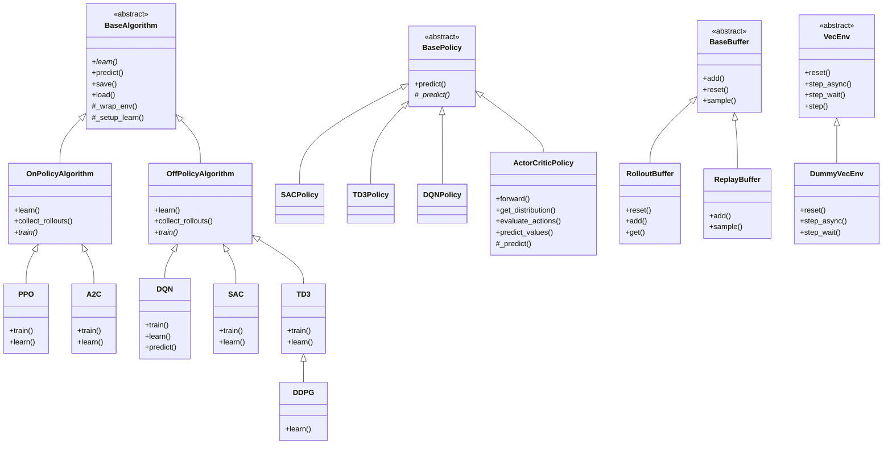
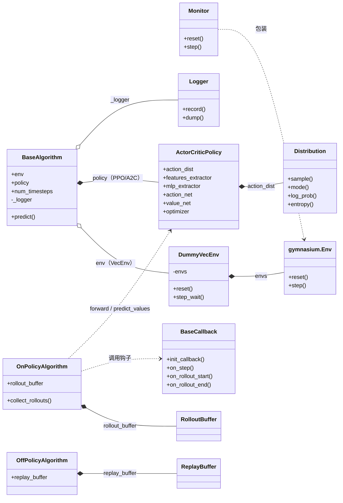

# 3. 核心领域对象与类图

本章回答：SB3 把一个 Gymnasium 环境组织成可训练、可预测的流程时，有哪些核心对象，各自负责什么，彼此是“继承”“持有”还是“调用”。源码均指[固定基线](../project-baseline.md)；证据编号见 [issue-02.md](../evidence/issues/issue-02.md)。限定：对象职责与持有关系（图 3-2）只以 PPO 主线为例；继承图（图 3-1）包含包内六个算法及其策略类。不分析 HER 和 Dict 观测以外的变体。

## 3.1 对象职责

| 对象 | 职责 | 源码 |
|---|---|---|
| `gymnasium.Env` | 用户提供的环境，只描述 `reset/step` 与观测、动作空间；不属于 SB3 | 用户代码；检查入口见第 5 章 |
| `Monitor` | 包装单个环境，记录回合回报与长度，写入 `info` | [Monitor](https://github.com/DLR-RM/stable-baselines3/blob/7cfb4dd6055e74b5caa4ed4d6777492209946e26/stable_baselines3/common/monitor.py#L17) |
| `VecEnv` / `DummyVecEnv` | 把一个或多个环境统一为批量接口；`reset()` 只返回观测，`step()` 返回 4 项 | [VecEnv](https://github.com/DLR-RM/stable-baselines3/blob/7cfb4dd6055e74b5caa4ed4d6777492209946e26/stable_baselines3/common/vec_env/base_vec_env.py#L50)、[DummyVecEnv](https://github.com/DLR-RM/stable-baselines3/blob/7cfb4dd6055e74b5caa4ed4d6777492209946e26/stable_baselines3/common/vec_env/dummy_vec_env.py#L15) |
| `BaseAlgorithm` | 算法公共骨架：解析策略、包装环境、保存/加载、`predict()` 入口；`learn()` 为抽象方法 | [BaseAlgorithm](https://github.com/DLR-RM/stable-baselines3/blob/7cfb4dd6055e74b5caa4ed4d6777492209946e26/stable_baselines3/common/base_class.py#L67) |
| `OnPolicyAlgorithm` | on-policy 训练循环：`collect_rollouts()` 采样，`train()` 由子类实现 | [OnPolicyAlgorithm](https://github.com/DLR-RM/stable-baselines3/blob/7cfb4dd6055e74b5caa4ed4d6777492209946e26/stable_baselines3/common/on_policy_algorithm.py#L21) |
| `OffPolicyAlgorithm` | off-policy 训练循环，使用 ReplayBuffer | [OffPolicyAlgorithm](https://github.com/DLR-RM/stable-baselines3/blob/7cfb4dd6055e74b5caa4ed4d6777492209946e26/stable_baselines3/common/off_policy_algorithm.py#L27) |
| `PPO` | 实现 `train()`：损失、minibatch 与优化步；`learn()` 只透传父类 | [PPO](https://github.com/DLR-RM/stable-baselines3/blob/7cfb4dd6055e74b5caa4ed4d6777492209946e26/stable_baselines3/ppo/ppo.py#L18)、[PPO.learn](https://github.com/DLR-RM/stable-baselines3/blob/7cfb4dd6055e74b5caa4ed4d6777492209946e26/stable_baselines3/ppo/ppo.py#L302) |
| `BasePolicy` / `ActorCriticPolicy` | 持有网络、优化器与动作分布；`predict()` 处理观测转换并调用 `_predict()` | [BasePolicy](https://github.com/DLR-RM/stable-baselines3/blob/7cfb4dd6055e74b5caa4ed4d6777492209946e26/stable_baselines3/common/policies.py#L280)、[ActorCriticPolicy](https://github.com/DLR-RM/stable-baselines3/blob/7cfb4dd6055e74b5caa4ed4d6777492209946e26/stable_baselines3/common/policies.py#L416) |
| `RolloutBuffer` | 存放本轮采样的观测、动作、回报、优势；`get()` 产出 minibatch | [RolloutBuffer](https://github.com/DLR-RM/stable-baselines3/blob/7cfb4dd6055e74b5caa4ed4d6777492209946e26/stable_baselines3/common/buffers.py#L343) |
| `ReplayBuffer` | 保留历史经验供 off-policy 随机采样 | [ReplayBuffer](https://github.com/DLR-RM/stable-baselines3/blob/7cfb4dd6055e74b5caa4ed4d6777492209946e26/stable_baselines3/common/buffers.py#L158) |
| `BaseCallback` | 训练钩子：`init_callback(model)` 后在采样/训练各阶段被调用 | [BaseCallback](https://github.com/DLR-RM/stable-baselines3/blob/7cfb4dd6055e74b5caa4ed4d6777492209946e26/stable_baselines3/common/callbacks.py#L31) |
| `Logger` | 汇总并输出指标（终端、TensorBoard 等） | [Logger](https://github.com/DLR-RM/stable-baselines3/blob/7cfb4dd6055e74b5caa4ed4d6777492209946e26/stable_baselines3/common/logger.py#L479) |
| `Distribution` | 把网络输出变为动作分布（Categorical、对角高斯等） | [Distribution](https://github.com/DLR-RM/stable-baselines3/blob/7cfb4dd6055e74b5caa4ed4d6777492209946e26/stable_baselines3/common/distributions.py#L26) |

## 3.2 类图

分两张图：图 3-1 只画**继承**（含 A2C、DQN、SAC、TD3、DDPG 及其策略类）并列出各类的主要方法，图 3-2 画**持有**与**调用**并列出相关属性。方法和属性只选与本报告主线（PPO 的预测与训练）相关的，不是完整成员列表；`*` 表示必须由子类实现（`@abstractmethod`，或基类中直接 `raise NotImplementedError`，如两个 `train()`），`#` 表示约定的内部方法。成员名已在固定基线上核对（行号见 3.1、3.3），两张图已用 Mermaid 11.4 渲染确认语法正确。

### 图 3-1 继承与主要方法

[Mermaid 源文件](../../artifacts/diagrams/issue-02/domain-inheritance.mmd)

### 图 3-2 持有、调用与主要属性

实心菱形为持有（对象作为属性），空心菱形为引用外部传入的对象，虚线为调用/依赖。[Mermaid 源文件](../../artifacts/diagrams/issue-02/domain-objects.mmd)

## 3.3 关系的源码依据

继承：

- `OnPolicyAlgorithm(BaseAlgorithm)`、`OffPolicyAlgorithm(BaseAlgorithm)`、`PPO(OnPolicyAlgorithm)`：见上表类定义行。DDPG 继承 TD3（[ddpg.py#L14](https://github.com/DLR-RM/stable-baselines3/blob/7cfb4dd6055e74b5caa4ed4d6777492209946e26/stable_baselines3/ddpg/ddpg.py#L14)），已在第 2 章核对。
- `ActorCriticPolicy(BasePolicy)`；PPO 的 `MlpPolicy` 只是别名：[ppo/policies.py#L5](https://github.com/DLR-RM/stable-baselines3/blob/7cfb4dd6055e74b5caa4ed4d6777492209946e26/stable_baselines3/ppo/policies.py#L5)。
- `RolloutBuffer`、`ReplayBuffer` 均继承 `BaseBuffer`（[#L27](https://github.com/DLR-RM/stable-baselines3/blob/7cfb4dd6055e74b5caa4ed4d6777492209946e26/stable_baselines3/common/buffers.py#L27)）。

持有：

- \`DummyVecEnv\` 持有环境列表 \`self.envs\`（[#L31](https://github.com/DLR-RM/stable-baselines3/blob/7cfb4dd6055e74b5caa4ed4d6777492209946e26/stable_baselines3/common/vec_env/dummy_vec_env.py#L31)）。
- 算法持有环境：`_wrap_env` 在需要时先加 `Monitor`、再用 `DummyVecEnv` 包成 VecEnv（[#L218-L224](https://github.com/DLR-RM/stable-baselines3/blob/7cfb4dd6055e74b5caa4ed4d6777492209946e26/stable_baselines3/common/base_class.py#L218)）。
- on-policy 算法在 `_setup_model` 中创建并持有 `rollout_buffer` 与 `policy`（[#L125-L138](https://github.com/DLR-RM/stable-baselines3/blob/7cfb4dd6055e74b5caa4ed4d6777492209946e26/stable_baselines3/common/on_policy_algorithm.py#L125)）；off-policy 对应创建 `replay_buffer` 与 `policy`（[#L208-L224](https://github.com/DLR-RM/stable-baselines3/blob/7cfb4dd6055e74b5caa4ed4d6777492209946e26/stable_baselines3/common/off_policy_algorithm.py#L208)）。
- `ActorCriticPolicy` 持有 `action_dist`（[#L533](https://github.com/DLR-RM/stable-baselines3/blob/7cfb4dd6055e74b5caa4ed4d6777492209946e26/stable_baselines3/common/policies.py#L533)）、`features_extractor`、`mlp_extractor`、`action_net`、`value_net` 与 `optimizer`（[_build #L585-L635](https://github.com/DLR-RM/stable-baselines3/blob/7cfb4dd6055e74b5caa4ed4d6777492209946e26/stable_baselines3/common/policies.py#L585)）。
- 算法持有 logger：`_setup_learn` 中用 `configure_logger` 设置（[#L431](https://github.com/DLR-RM/stable-baselines3/blob/7cfb4dd6055e74b5caa4ed4d6777492209946e26/stable_baselines3/common/base_class.py#L431)）。

调用/依赖：

- `collect_rollouts` 在采样中调用 `callback.on_step()` 等钩子（[#L192-L266](https://github.com/DLR-RM/stable-baselines3/blob/7cfb4dd6055e74b5caa4ed4d6777492209946e26/stable_baselines3/common/on_policy_algorithm.py#L192)），回调通过 `init_callback(model)` 反向拿到算法引用（[#L68-L74](https://github.com/DLR-RM/stable-baselines3/blob/7cfb4dd6055e74b5caa4ed4d6777492209946e26/stable_baselines3/common/callbacks.py#L68)）。注意回调是**参数**传入 `learn()`，不是算法的属性，所以图中用虚线。
- 采样时的策略调用是 `self.policy(obs_tensor)`，即 `forward`（[#L202](https://github.com/DLR-RM/stable-baselines3/blob/7cfb4dd6055e74b5caa4ed4d6777492209946e26/stable_baselines3/common/on_policy_algorithm.py#L202)）；而用户调用 `predict()` 走 `_predict` 而不进入 `forward`（第 4 章，C-03-05）。两条路径不同，不能混为“策略被调用”一件事。

## 3.4 生命周期

1. **创建**：用户把策略名（如 `"MlpPolicy"`）和环境交给 `PPO(...)`；`BaseAlgorithm.__init__` 解析策略类并包装环境（[#L106-L175](https://github.com/DLR-RM/stable-baselines3/blob/7cfb4dd6055e74b5caa4ed4d6777492209946e26/stable_baselines3/common/base_class.py#L106)）；`_setup_model` 创建 buffer 与 policy。
2. **训练**：`learn()` 先 `_setup_learn`（重置环境、配置 logger 与回调），再循环“采样 → 计算回报 → 训练”；每轮 \`collect_rollouts\` 开头调用 \`rollout_buffer.reset()\`（[#L187](https://github.com/DLR-RM/stable-baselines3/blob/7cfb4dd6055e74b5caa4ed4d6777492209946e26/stable_baselines3/common/on_policy_algorithm.py#L187)），数组重新分配归零（C-04-05）。
3. **预测**：`predict()` 不依赖 buffer，只需 policy 与观测，可在训练前后任意调用。
4. **保存/加载**：见第 2 章 2.3 节；加载时新环境的空间须与原环境一致。

## 3.5 证据边界

- 本章结论以**源码静态证据**为主；类图属于结构性陈述，没有对应的运行实验，因此在证据文件里状态为“待验证”，复核人可用 `python -c` 检查 `isinstance`/属性存在性来补运行证据。
- SAC、TD3、DQN 的策略对象（如 [SACPolicy](https://github.com/DLR-RM/stable-baselines3/blob/7cfb4dd6055e74b5caa4ed4d6777492209946e26/stable_baselines3/sac/policies.py#L181)、[TD3Policy](https://github.com/DLR-RM/stable-baselines3/blob/7cfb4dd6055e74b5caa4ed4d6777492209946e26/stable_baselines3/td3/policies.py#L86)、[DQNPolicy](https://github.com/DLR-RM/stable-baselines3/blob/7cfb4dd6055e74b5caa4ed4d6777492209946e26/stable_baselines3/dqn/policies.py#L88)）直接继承 `BasePolicy`，不具备 `ActorCriticPolicy` 的 `action_dist`/`value_net`；图中的策略分支仅适用于 PPO/A2C。
