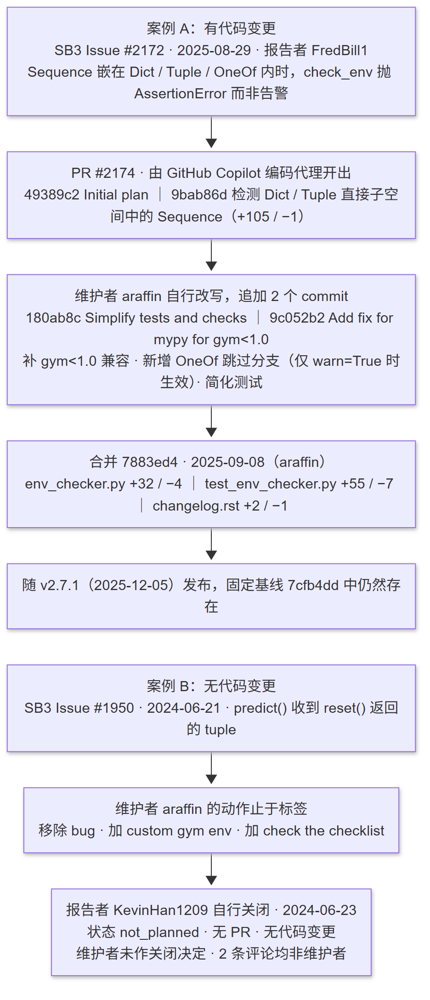

# 7. 维护观察

本章选取一组与报告主线相关的已关闭 Issue，串联「问题 → 讨论 → 决定 → 变更 → 回归测试」，并核对固定源码基线中的最终状态。事实结论指向[上游源码基线](../project-baseline.md)（`7cfb4dd6055e74b5caa4ed4d6777492209946e26`）与[任务证据](../evidence/issues/issue-08.md)。

## 7.1 观察方法与选取标准

维护历史只有在满足两个条件时才纳入本章：其一，与报告主线相关，即本报告第 5 章关注的 `check_env()` 与 `VecEnv` API 边界；其二，链条完整可核，即复核人能从 Issue 找到 PR/commit，再找到实际改动或回归测试。

据此取两条：

| 案例 | 链条 | 性质 |
|---|---|---|
| A. Issue #2172 → PR #2174 → merge commit `7883ed4` | 完整：问题、讨论、4 个 commit、3 个文件改动、回归测试、变更日志 | 有代码变更 |
| B. Issue #1950 → `not_planned` 关闭 | 无 PR、无 commit；**关闭者是报告者本人**，维护者动作止于标签调整 | 无代码变更 |

选一条「有代码变更」和一条「无代码变更」并列，是为了看清维护者在做什么判断，而不只是看到了哪些改动。这里需要先说明一个边界：案例 B 的关闭动作由报告者本人完成，维护者只调整了标签，因此它**不能**被当作「维护者判定不改」的证据；本章 7.3 按此表述。

[Mermaid 源文件](../../artifacts/diagrams/issue-08/maintenance-chain.mmd)

## 7.2 主案例：一次「AI 提出、人工改写后合并」的修复

### 7.2.1 问题

上游 Issue #2172（2025-08-29，由 FredBill1 报告）指出：`Sequence` 观测空间一旦被放进 `Dict`、`Tuple` 或 `OneOf` 这类复合空间，`check_env()` 会直接抛 `AssertionError` 或 `TypeError`，而不是按既有约定告警并跳过返回值检查。报告者给出了覆盖三种复合空间 × `stack` 两种取值的完整最小复现脚本。

这个问题的意义在于它暴露了检查器自身的盲区，而不是用户环境的错误：顶层 `Sequence` 已能被识别并跳过检查，嵌套之后却被漏掉，于是检查器对返回值的合法性做出了它本不该做的断言。

### 7.2.2 决定与变更

修复由 GitHub Copilot 编码代理开出的 PR #2174 提出。该 PR 含 4 个 commit，其中 2 个来自 Copilot、2 个来自维护者 araffin：

| 顺序 | commit | 作者 | 提交信息 | 变更量 |
|---|---|---|---|---|
| 1 | `49389c2` | `copilot-swe-agent[bot]` | Initial plan | — |
| 2 | `9bab86d` | `copilot-swe-agent[bot]` | Fix env checker to handle Sequence spaces in composite spaces | +105 / −1 |
| 3 | `180ab8c` | **araffin（维护者）** | Simplify tests and checks | +58 / −85 |
| 4 | `9c052b2` | **araffin（维护者）** | Add fix for mypy for gym<1.0 | +2 / −2 |

链条的关键在于第 2→3 步之间发生了什么：**维护者没有直接合并 AI 的补丁，而是自己重写后才合并**。可核对的差异有三处：

1. **补上向后兼容保护。** AI 原始提交直接写 `isinstance(observation_space, spaces.OneOf)`，在 Gymnasium < 1.0 下会因属性不存在而 `AttributeError`；维护者改为 `_is_oneof_space()` 守卫（`try / except AttributeError`），第 4 个 commit 又补了 `# type: ignore[attr-defined]` 以通过 mypy。类型检查与旧版本兼容是合并前的实际门槛。
2. **重新划定边界。** AI 的原始方案只在 `OneOf` 内部查找 `Sequence`；维护者改成对 `OneOf` 本身直接告警并置 `should_skip=True`。也就是说，**`OneOf` 观测空间不再做返回值检查这一行为，是维护者在改写时新增的**，不属于 AI 原始提案。这一点需要限定条件才准确：该分支只在 `warn=True` 时生效——`_check_unsupported_spaces()` 仅在 `check_env()` 的 `if warn:` 分支内被调用（基线 `env_checker.py:L501-502`），`warn` 默认为 `True`；显式传 `warn=False` 时既不告警也不跳过检查。
3. **简化测试。** AI 原始提交新增了三个独立的 `gym.Env` 子类，各自复制一遍 `reset`/`step`，并参数化 `stack=[False, True]`；维护者改为继承仓库既有的 `CustomEnv`、去掉参数化，把测试规模压了下来（该 commit 净 −85 / +58）。

从讨论与决定的先后看，AI 提供的是一个方向正确的根因判断：它指出检查器没有覆盖复合空间内部的 `Sequence`，于是检查器对这些返回值做出了本不该做的断言。这一判断经与最终 diff 和基线源码对照后成立。但需要修正 AI 自述中的一处用词：PR 正文称其「recursively」检查，而无论 AI 的原始提交还是合并态，实现都只遍历 `Dict` / `Tuple` 的**直接子空间**一层（基线 `env_checker.py:L105`、`L140`），**并非任意层级递归**——形如 `Dict → Tuple → Sequence` 的两层嵌套仍不会被识别。**方案落地时的兼容性、边界范围和测试规模，则是在人工改写阶段才定下来的。**

合并结果：2025-09-08T15:48:22Z 由 araffin 合并，merge commit `7883ed4d20bc9edf3a22a053c77b3146c518a937`，相对 base 改动 3 个文件、+89 / −12：

| 文件 | 改动 |
|---|---|
| `stable_baselines3/common/env_checker.py` | +32 / −4 |
| `tests/test_env_checker.py` | +55 / −7 |
| `docs/misc/changelog.rst` | +2 / −1 |

### 7.2.3 回归测试

变更同时补了回归测试：新增 `SequenceInDictEnv`、`SequenceInTupleEnv`、`SequenceInOneOfEnv` 三个测试环境，把原有的 `test_check_env_sequence_obs` 参数化为 `[CustomEnv, SequenceInDictEnv]`，并为 Tuple 场景要求同时匹配 `Sequence.*` 与 `Tuple.*` 两条告警、为 OneOf 场景用 `pytest.skip` 兜底 Gymnasium 版本不支持的情形。固定基线中的位置是 `tests/test_env_checker.py:L221-273`（该文件共 273 行）。

这层测试是本节最可复核的落点：**7.2.2 第 2 点所说的「OneOf 被新增为跳过检查」不是从讨论里读出来的推断，而是由 `test_check_env_oneof` 这条断言显式固定的**，复核人可在固定基线下独立运行验证。

### 7.2.4 落到基线

| 核对项 | 固定基线 `7cfb4dd` 的实际状态 |
|---|---|
| `should_skip = graph_space = sequence_space = False` | `stable_baselines3/common/env_checker.py:L102` |
| `Dict` 内 `Sequence` 识别（遍历直接子空间） | 同文件 `L105`（`observation_space.spaces.items()`）、`L110-111` |
| `Tuple` 内 `Sequence` / `Graph` 识别（遍历直接子空间） | 同文件 `L140-144` |
| `OneOf` 告警 + `should_skip=True` | 同文件 `L146-152`（守卫函数 `L12-20`） |
| `Sequence` 或 `sequence_space` 告警 + `should_skip=True` | 同文件 `L156-162` |
| 上述告警与跳过的 `warn` 门控 | 同文件 `L501-502`，调用点位于 `check_env` 的 `if warn:` 分支内 |
| 无任意层级递归 | 同文件 `L95` 定义、`L502` 唯一调用点，全文件仅 2 处 `_check_unsupported_spaces` |
| 新增测试用例 | `tests/test_env_checker.py:L221-273` |
| 变更日志条目 | `docs/misc/changelog.md:L158`，位于 `## Release 2.7.1 (2025-12-05)` 的 Bug Fixes 段 |

基线 commit 本身是 `7cfb4dd Fix for too many open files with subproc vec env (#2284)`，晚于该修复，因此本节结论与基线不冲突。该修复随 **v2.7.1（2025-12-05）** 发布。

上表由 `scripts/issue_08_verify_chain.py` 机械核对：脚本逐项断言上述标记存在，并在 SB3 目录的 Git HEAD 等于固定基线时进一步校验行号；本次运行 **16 项全部 PASS**，记录见 [`artifacts/runs/issue-08/2026-10-15-review-fixes/`](../../artifacts/runs/issue-08/2026-10-15-review-fixes/summary.md)。这条脚本是复核人验证本章 C-08-02、C-08-03、C-08-05、C-08-06 的最短路径。

**一处需要重新定位的路径变化。** PR #2174 改动的是 `docs/misc/changelog.rst`，而基线中该文件已更名为 `docs/misc/changelog.md`。需要说明的是，**历史链接本身并未失效**：PR 页面上的文件链接指向该 PR 自身 base/head 的 commit，按 commit 定位仍然可访问；发生变化的是**跨版本的文件路径**，若要按路径跳到固定基线上的同名文件，必须重新定位（`changelog.rst` → `changelog.md`）。这一点只有真正去核对基线才会发现。

**与第 5 章的交叉印证。** 7.2.2 第 2 点新增的「`OneOf` 告警并跳过返回值检查」，与 T05 的结论 C-05-07（`Sequence`/`Graph`/`OneOf` 会告警并跳过全部返回值检查）指向同一段代码。维护历史进一步说明了该行为的**来源、引入时间与生效条件**：它是 2025-09 才被加上的，由维护者在改写 AI 补丁时加入，并且只在 `warn=True` 时生效。这为「`check_env` 通过 ≠ 环境正确」这条边界结论补上了历史维度。

## 7.3 对照案例：一次没有产生代码变更的关闭

Issue #1950（2024-06-21）报告的是一段 `predict()` 报错：用户在 `learn.py` 示例中把 Gymnasium `reset()` 返回的 `(obs, info)` 元组整体传给了 `model.predict()`，于是 `policies.py` 抛出 `ValueError: You have passed a tuple to the predict() function instead of a Numpy array or a Dict.`

维护者 araffin 的实际动作只有标签层面（标签名与其描述文本可核）：

- 移除 `bug`；
- 改加 `custom gym env`（"Issue related to Custom Gym Env"）；
- 改加 `check the checklist`（"You have checked the required items in the checklist but you didn't do what is written..."）；
- 该 Issue 于 2024-06-23 以 `state_reason = not_planned` 关闭，**全程没有代码变更，也没有 PR**。这里必须明确：**关闭它的是报告者本人 KevinHan1209**（`closed_by = KevinHan1209`，与其 `user` 账号一致），不是维护者。维护者可核对的全部动作只有上面三条标签调整，因此本案例不能被表述为「维护者判定不改并关闭」。

该 Issue 共 2 条评论，`author_association` 均为 `NONE`，**都不是维护者**：@sidrai111 在 2024-12-14 问 "Did you find the solution?"；@nyakotey 在 2025-05-14 给出正确写法——把 `obs = test_env.reset(seed=42, options={})` 改为 `obs, info = test_env.reset(seed=42, options={})`。

对照价值在于：**这个报错本身就被设计成解决方案的一部分。** 固定基线 `stable_baselines3/common/policies.py:L357-362` 保留了这段报错文本，其中直接写明「You are probably mixing Gym API with SB3 VecEnv API」并附上文档链接。就本次观察到的材料而言，这类「用户误用」问题没有被转成代码改动，而是由报错文本与文档承担引导职责。

需要明确的是：**维护者改标签时的判断依据，属于小组推断，不是事实。** Issue 中没有维护者的文字评论，只有标签事件；`commit message` 只描述动作（"Simplify"、"Add fix for mypy for gym<1.0"），未说明理由。同时，**关闭动作来自报告者本人，不应被当作维护者的判断**。这条推断在[任务证据](../evidence/issues/issue-08.md)中标为「待验证」（C-08-10）。

## 7.4 对维护方式的启示

从这两个案例可归纳出三点，均限于本次观察到的范围：

1. **维护者的核心动作是「分类」，而不只是「改代码」。** 案例 A 走的是「确认缺陷 → 接受补丁 → 改写 → 合并」，案例 B 走的是「改标签重新分类 → 报告者自行关闭」。两个案例中真正决定走向的，都是先判断这属于哪一类问题。案例 B 尤其说明：属于使用误用的问题，最终不会被转成代码改动。但这里只能确认到「维护者做了重新分类」这一层——关闭由报告者作出，不能扩写成「维护者判定不改」。
2. **AI 可以提高提案速度，但不改变合并门槛。** 案例 A 中 AI 给出的根因判断是准确的，补丁方向也正确，但维护者仍追加了 2 个自己的 commit，处理点集中在旧版本兼容、mypy 与测试规模——这些都不是「代码能不能跑」的问题，而是项目自身规范的约束。这正好是本报告第 6 章想要记录的那类「AI 输出需经人工核验」的具体形态。值得一提的还有一处细节：AI 在 PR 正文中把自己的改动说成是「recursively」检查，而实际实现只覆盖直接子空间一层——**AI 对自己输出的描述本身也需要被核验**。
3. **改动会扩散到测试与变更日志，而不止于源码。** 案例 A 的 3 个改动文件中只有 1 个是源码，另两个是回归测试与 changelog；而 changelog 又在后续重构中改名（`changelog.rst` → `changelog.md`），按路径引用时需重新定位。维护状态的可靠来源是固定 commit 本身，不是 Issue 页面上的描述。

## 7.5 本章的边界

- 只核对已发生的维护历史与固定基线中的最终状态，不评价该修复方案的技术优劣，也不修改上游 SB3 仓库。
- 案例限于 `env_checker` 与 `VecEnv` API 这条主线，未复盘 PPO 算法与训练效果。
- 未运行上游测试套件：本章的证据类型是 Issue/PR/commit 历史加源码定位。已运行的是只读的 `scripts/issue_08_verify_chain.py`；若需把 `test_check_env_oneof`、`test_check_env_sequence_tuple` 等用例实际跑一遍，可在固定基线下执行 `pytest tests/test_env_checker.py`。
- 维护者的**动机**无文字记录可考，本章只写「改了什么」，不写「为什么这么改」。
- 本章经第一期复核（2026-10-15）修正了三处表述：Issue #1950 的关闭者身份、`Sequence` 检测的层级范围与 `warn` 条件、以及文件路径变化的表述。修正的依据与过程见[任务证据](../evidence/issues/issue-08.md)的「复核记录」。
